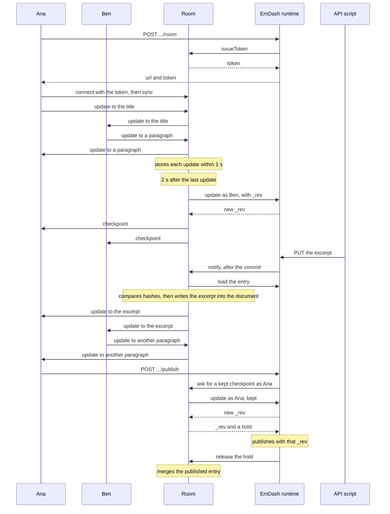

# Real-time co-editing

> **Draft.** Open before acceptance: a Maintainer sponsor, and the prototype results for the [acceptance gates](#acceptance-gates).

## Summary

This RFC lets several people edit one entry in the admin editor at once. Each person sees who else is editing and where, concurrent rich-text edits merge, and undo reverts only that person's edits.

- **A room per entry syncs and saves.** A server-side room holds the entry's shared Yjs document and relays edits and presence over WebSockets. It is a Durable Object on Cloudflare Workers and an in-process object on Node.js. It saves through the same steps as today's autosave, so permissions, hooks, validation and revisions work as they do today, and content stays Portable Text.
- **Every other write merges in.** REST, MCP, the CLI, the visual editor and plugins write as they do today, and the room copies their changes into the shared document unless someone in the room changed the same field.
- **On by default** wherever the host can run rooms. Elsewhere, editing works as it does today.

Co-editing applies to collections with revisions. Presence for agents and API callers, comments and suggestions are out of scope.

## Problem and user case

Only one person can edit an entry at a time. Edit locking ([Discussion #2819](https://github.com/emdash-cms/emdash/discussions/2819)) is on by default: the first person to open an entry holds its lock, and everyone else gets **Open read-only** or **Take over**. With locking off, a save based on an older `_rev` gets `409 CONFLICT`. Nothing merges, so teams take turns, or draft in another tool and paste, which loses Portable Text structure.

The Ideas Discussion ([#4173](https://github.com/emdash-cms/emdash/discussions/4173)) asked for the [goals](#goals) below. A reply asked who answers for a publish that holds several people's edits: revisions record everyone whose edits they hold, and the publish dialog names them.

### Prior art

- **WordPress 7.0** relayed Yjs updates between browsers, which saved through the normal requests, and removed it before release ([Gutenberg #72373](https://github.com/WordPress/gutenberg/pull/72373), [removal post](https://make.wordpress.org/core/2026/05/08/rtc-removed-from-7-0/)). Its next design is server-aware, because a browser that fell behind could save over newer work, REST writes couldn't reach open editors, and a privileged browser could save a less privileged collaborator's content ([server-aware post](https://make.wordpress.org/core/2026/09/18/moving-to-a-server-aware-approach-for-collaboration/)).
- **JupyterLab and PreTeXt-Plus** also moved saving from the browser to the server ([JupyterLab #11599](https://github.com/jupyterlab/jupyterlab/pull/11599), [PreTeXt-Plus #414](https://github.com/PreTeXtPlus/PreTeXt-Plus/pull/414)). **Yjs servers** such as Hocuspocus and y-partyserver recover updates lost in a restart from clients.
- **The Yjs author's model** for apps whose database is the source of truth starts each session from the database and forgets it an hour after the last client leaves. Clients from a forgotten session can't merge ([Lexical FAQ](https://lexical.dev/docs/collaboration/faq)).

This design is server-aware: the room is the only saver, outside writes reach open editors, and each save is authorized as a co-editor.

## Example

Ana (Editor role) opens the post "Spring launch", which Ben (Author role) already has open, and each sees the other's avatar and cursor. Ana edits the title while Ben rewrites a paragraph. Two seconds after the last edit, the room saves both people's edits, and both editors show "Saved".

Ben's Wi-Fi drops for twenty seconds. He keeps typing, and his edits merge and save when he reconnects. A script with Ana's API token updates the excerpt, and the new excerpt appears in both editors within a second. Ana publishes: the room saves, the post is published, and Ben's later edits are unpublished changes.

## Goals

- **Concurrent editing** of the entry form, with every replica converging.
- **Presence:** avatars, each person's field, and named cursors in rich text. Remote edits render within 500 ms at the 95th percentile.
- **Per-person undo.**
- **Short disconnects.** A client that reconnects within an hour of everyone leaving merges its offline edits. Edits that can't merge are kept as a revision.
- **"Saved" is true.** A client shows "Saved" only when a save holds all its edits.
- **Live outside writes,** shown in open editors within a second.
- **Deliberate publishing.** Publishing is one operation, by someone with publish permission, on a save made at that moment.
- **Hosts:** Cloudflare Workers and single-process Node.js, over WebSockets, with no third-party service and no Cloudflare code in `emdash`.
- **On by default,** with no added queries on logged-out routes.

## Non-goals

- Presence for agents and API callers. Their writes merge, but they have no cursor, presence or undo.
- Comments, suggestions, tracked changes and approval workflows.
- Offline edits that outlive the room or the tab.
- Co-editing in the visual editor, whose writes still merge into open rooms.
- Merging inside fields other than rich text, `blocks` and `repeater` included.
- A per-collection setting.

## Detailed design

[Appendix A](#appendix-a-interfaces) holds the protocol, interfaces and tables, and [Appendix B](#appendix-b-limits) the timings and limits.

### Current behavior

- **Autosave** sends the whole form 2 s after typing stops, as the content `PUT` with `skipRevision: true` and `_rev`. A stale `_rev` gets `409 CONFLICT`. The route checks edit permission and the edit lock, then runs the runtime's update, with `content:beforeSave` hooks. Each draft save creates a revision, and `skipRevision` deletes the previous draft revision, even one a manual save created.
- **Edit locks** belong to a user, admit all of that user's sessions, and are renewed by a heartbeat every 2 minutes.
- **Other writes.** The visual editor saves one field at a time, without `_rev`. Plugin `ctx.content.update` skips hooks, validation and the edit lock. SEO, author and publication date write the live row at once, taxonomy terms save through their own route, and bylines and reference fields ride the form save.
- **The editor schema** is built inside the admin's React editor, which has its own Portable Text converter.

### Yjs in brief

Yjs is the CRDT library co-editing uses. The rest of this RFC relies on these facts about it:

- A **`Y.Doc`** is a document that each client keeps a copy of, called a replica. Every change makes an **update**, a binary diff. Replicas that apply the same updates, in any order and any number of times, hold the same document.
- Yjs merges by **item identity**, not by content. Each inserted item records the client ID that wrote it and a counter. Two documents built separately from the same entry share no items, so merging one into the other duplicates every block.
- A **state vector** records how far a replica has got in each client's edits. Deletions are kept apart, in a **delete set**. A **snapshot** holds both, so it also notices an edit that only deletes. Snapshot A **contains** B when A's state vector is at least B's and A's delete set includes B's.
- **Sync** has two steps, as y-protocols defines them: each side sends its state vector (step 1), and the other replies with the updates it lacks (step 2). After that, updates flow as they happen.
- **Awareness** is a separate y-protocols channel for each client's short-lived state, such as its cursor. It's never stored.
- `@tiptap/y-tiptap` binds a **`Y.XmlFragment`** to the ProseMirror editor. Reading a fragment through a ProseMirror schema deletes, from the shared document itself, every node or mark the schema rejects, such as an unknown type, so a document must be read only with the schema that built it.

### Terms

| Term                 | Meaning                                                                                                                                                                                                                                                                                                        |
| -------------------- | -------------------------------------------------------------------------------------------------------------------------------------------------------------------------------------------------------------------------------------------------------------------------------------------------------------- |
| Room                 | The server-side object for one entry row (each locale is a row). It holds the shared document, relays updates and presence, saves the document, and merges outside writes into it.                                                                                                                             |
| Open                 | A room is open while it has connections or unused, unexpired tokens, and for 10 s after its last connection closes                                                                                                                                                                                             |
| Shared document      | The room's `Y.Doc`, which each client (an editor tab) replicates                                                                                                                                                                                                                                               |
| Stored entry         | The entry row and its revisions in the site database                                                                                                                                                                                                                                                           |
| Room storage         | Where a room keeps its document and room record ([Data model](#data-model)): the Durable Object's SQLite on Workers, two site-database tables on Node.js                                                                                                                                                       |
| Co-editor, viewer    | A user connected with write access, or with read access only                                                                                                                                                                                                                                                   |
| Checkpoint           | A snapshot recorded when every edit in it has been saved. An update is **covered** when the last checkpoint contains it. The room records a checkpoint at initialization, at each save, including one skipped because nothing changed, and after a merge into a document with nothing uncovered.               |
| Kept checkpoint      | A checkpoint made for **Save** or an operation, whose revision later autosaves don't replace. It's saved without `skipRevision`, or marks the draft revision as kept when nothing changed.                                                                                                                     |
| Merge base           | The stored entry's `_rev`, and each field's hash in the stored entry and in the document, as of the last checkpoint or merge. Comparing with it shows which side changed a field since.                                                                                                                        |
| Actor                | The user a checkpoint is saved as: the co-editor who sent its latest update, or the user who asked for it by sending `save` or running an operation                                                                                                                                                            |
| Shared editor schema | The admin editor's ProseMirror schema and Portable Text converter, in a DOM-free subpath export of `@emdash-cms/admin` that the editor and rooms share                                                                                                                                                         |
| Lineage              | A random ID for one continuous room state. A room that starts from the stored entry starts a new lineage.                                                                                                                                                                                                      |
| Fingerprint          | Identifies an EmDash build and its editor schema: the admin manifest's `version`, `commit` and `hash`, which change with EmDash upgrades and with collection, plugin or taxonomy definitions. A client sends the `version` and `commit` built into its admin bundle, and the `hash` its editor was built from. |
| Single-editor mode   | Today's behavior: the client takes a user lock, or opens read-only                                                                                                                                                                                                                                             |
| Operation            | Publish, schedule, unpublish, unschedule, restoring a revision, discarding the draft, or moving to Trash                                                                                                                                                                                                       |
| Reset                | A client discards its replica and joins again, first saving its whole document as a recovery revision if it holds uncovered edits                                                                                                                                                                              |
| Recovery revision    | A revision marked `recovery` that holds edits the room or a client couldn't save. It is never the draft or the live one.                                                                                                                                                                                       |

"The editor" is the admin entry editor. Editor, Author and Contributor are roles.

### Architecture

Editors exchange edits only with the room, over a WebSocket. The room saves through the site's content update steps, and the site notifies the room after every other write. The [Example](#example), step by step:



### Guarantees

1. **One room per entry.** An entry's edits merge and save in one place: Workers runs one Durable Object per name, and Node.js keeps one room registry in a single process.
2. **One lineage.** A client merges only into the lineage it started from, and resets otherwise, because merging a replica of another document duplicates its content.
3. **One saver.** Only the room saves the shared document, so a browser that fell behind can't save over newer work. The room's saves send `_rev`, so none lands over a write it hasn't merged.
4. **One step at a time.** The room runs initialization, saves and merges one at a time, so each checkpoint contains the one before it.
5. **Room storage holds every saved update.** Before each save, the room stores every update that save holds. Otherwise a restart could leave the document without edits the stored entry has, and the next save would remove them.
6. **"Saved" means covered.** A client shows "Saved" when the last checkpoint contains its replica's snapshot from its own last edit, and otherwise asks before its tab closes.
7. **Hook output stays out.** The room writes stored values into the document only when it merges an outside write, never from its own save's response, so its saves never rewrite text people are typing.

### The shared document

| Field                                                                                                                | Yjs type                                                                                                            | Concurrent edits                                                 |
| -------------------------------------------------------------------------------------------------------------------- | ------------------------------------------------------------------------------------------------------------------- | ---------------------------------------------------------------- |
| `portableText`                                                                                                       | A `Y.XmlFragment` per field, bound to TipTap by `@tiptap/extension-collaboration` and `@tiptap/y-tiptap` (both MIT) | Merge. Every concurrent insertion is kept.                       |
| The slug, and every other field in `data` except reference fields (`blocks`, `repeater` and plugin widgets included) | One value in a `Y.Map`                                                                                              | One of the concurrent changes is kept, the same on every replica |

- **Values outside the document** are SEO, author, publication date, taxonomy terms, bylines and reference fields. In a room, each saves at once, without `_rev`, sending only what changed: bylines and reference fields leave the form save, and reference fields save with `skipRevision`, as autosaves do. A failed save keeps the value in its input, with today's error. Other clients reload a changed value once its input doesn't have focus.
- **Keys.** The client that creates a Portable Text block assigns its `_key` in the same transaction, including on split and paste. The shared converter derives any other missing or duplicate key, of a block, span or mark definition, from the node's position, so a document always serializes to the same Portable Text.
- **Normalizing plugins,** such as the trailing paragraph, ordered-list joining and table keys, act only on what the client's own transaction changed. The room writes initial documents, merges and overwrites in the form those plugins produce, so opening an entry or receiving a merge makes no client write.
- **Undo.** Rich text and the slash menu use `Y.UndoManager`, limited to the client's own origin, instead of TipTap's `undoRedo`. Other inputs keep the browser's undo, and room merges are in no one's undo history.
- **Presence** is Yjs awareness: each client's field and, in rich text, its cursor and selection. The room sets each connection's user from its token, and relays awareness only for the first Yjs client ID the connection announces, if no other connection holds it. Viewers appear by name only, with no cursor or field.
- **Plugin UI.** The plugin block modal edits the block by `_key`, not position, and refuses if the block is gone. A remote change remounts a field widget when the widget doesn't have focus, and a plugin editor action is one undo step.

### Joining a room

The client calls `POST /_emdash/api/content/{collection}/{id}/room` with its session, `X-EmDash-Request` and fingerprint. API tokens are refused. The join route writes no content, so the site-write fence, which blocks writes during a site transfer import or media usage activation and records them for running exports, ignores it. The route returns:

- **A room,** as `{ url, token }`, for callers with `content:read_drafts`. Users whom `requireEntryEditPerm` allows join as co-editors, and the rest as viewers. The route gets the token from the room, passing the entry's `_rev`, status and author as it checked them. At a connection limit, the client opens read-only.
- **Single-editor mode** when co-editing is off, the collection has no revisions, the host can't run rooms, the session is a playground, or the caller already holds the entry's user lock, for example in another tab, and shares it as today. Also when the room won't run: it can't store, or it must initialize and the entry is over 1 MB or has rich-text marks the editor can't represent.
- **`ENTRY_LOCKED`** when another user holds a user lock. **Take over**, which needs edit access as today, repeats the join with `takeover: true` and deletes that lock.
- **`409 CLIENT_OUTDATED`** when the fingerprint differs from the server's. The client saves its uncovered edits as a recovery revision and reloads the admin.

Rooms take no edit lock. While a room is open, today's lock route reports the room as the entry's holder and grants no user lock, and the route's `POST`, which takes and renews locks, deletes any user lock it finds. Single-editor tabs therefore open read-only, and a tab displaced by **Take over** turns read-only at its next heartbeat.

The token is random, single use, valid for 60 s, kept in the room's memory, and bound to the user, their name, the access level and the fingerprint. Every connection, reconnects included, needs a fresh token, and the room refuses an upgrade without a valid one. The client connects to `/_emdash/rooms/{collection}/{id}?token=…`, receives `welcome`, and stays read-only until y-protocols sync completes.

- **Initialize.** A room without state, when asked for a token, loads the stored entry, builds its document with the shared editor schema, and picks a lineage. It records the document's snapshot as the last checkpoint, and the entry as the merge base, with document hashes from the new document.
- **Lineage.** A client whose replica comes from another lineage resets.
- **Stale entry.** Before it answers a token request, the room merges the entry if the `_rev` sent with it differs from the merge base's, and always if the room isn't open. If the entry's status or author then differs from what the route checked, the room refuses the token, and the route checks access again.
- **Another build.** The room refuses a token whose `version` or `commit` isn't its own build's, and the client opens in single-editor mode.
- **Stale room.** If a token's fingerprint differs from the room record's, an entry the room loads has another `hash`, or the room loads a document that another EmDash build made, the room never reads that document with the schema. It saves any uncovered updates as a recovery revision, closes every connection with `rejoin`, drops its state, and initializes again when asked for a token.
- **Connection lifetime.** On every message, the room closes connections older than 15 minutes. Those clients join again, which rechecks their session and access.

### Updates and room storage

- **Updates.** The room applies updates only from co-editors, up to 1 MB each. An update that is too large or doesn't decode closes its connection with `reset`. Viewers send only sync step 1 and awareness, and the room ignores anything else from them. A client sends incremental updates only after its sync step 2.
- **Presence** is relayed, never stored, and removed when its connection closes.
- **Storing.** The room relays each update at once, and stores it within 1 s.
- **Restarts.** After a deploy, an eviction or a crash, the room loads its document from room storage when a message needs it, writes with a new Yjs client ID, and gets missing updates from reconnecting clients' sync step 2, credited to those clients' users. An update is lost only if the room lost it and every client that held it is gone, so it was never "Saved".
- **Dropping state.** An hour after its last store or closed connection, if it isn't open, the room saves any uncovered updates as a recovery revision, never into the draft, and drops its state. If that fails, it keeps its state and tries again an hour later. A room still holding state past that hour drops it before it answers a token request. A drop first forgets unused tokens, and token requests wait until it ends.
- **Compaction.** Past 1 MB of appended updates, the room replaces them, in one transaction, with one state from `Y.encodeStateAsUpdate`. The document keeps Yjs garbage collection on. Values over 1 MB are stored in parts. A compacted state over 2 MB means the document has outgrown rooms: the room saves, closes every connection with `rejoin`, and drops its state, falling back as a drop does if the save fails. Joins then initialize again, in single-editor mode if the entry is over 1 MB.

### Saving

Each save that sends fields is one call to the content update steps, made as one user. It sends only the fields that differ from the merge base, with the merge base's `_rev`.

- **When.** The room saves 2 s after the latest update from a co-editor, and at least every 10 s while such updates keep arriving. During an operation's hold ([Operations](#operations)) it waits, and saves when the hold ends if such updates arrived. A merge alone doesn't start a save. The room also saves after loading uncovered updates from room storage, when the last co-editor leaves, when a client sends `save`, and when an operation asks. The last two make kept checkpoints, saved as the requesting user.
- **How.**
  1. In one synchronous step, the room takes the document's snapshot and serializes the fields that updates touched since the last checkpoint, plus fields where a merge kept the document's value, or every field after loading from room storage. It reads rich text as ProseMirror JSON without a schema, which can't change the document, and converts it with the shared converter.
  2. It stores every update the snapshot holds.
  3. It sends the fields whose hash differs from the merge base, as the actor, with the merge base's `_rev`, `skipRevision: true` unless the checkpoint is kept, and `editedBy` (the users whose updates the snapshot adds since the last checkpoint).
- **Nothing to send.** If no field differs, the room records the snapshot as the last checkpoint and broadcasts `checkpoint`, without saving. For a kept checkpoint, it first marks the draft revision, if there is one, as kept, after the same `_rev` check, without changing `_rev`.
- **Record.** After a save, the room records the snapshot as the last checkpoint and updates the merge base from the save's own write, never from a later read, which can include another write: the `_rev` the write produced, the hash of every value it stored, and the hash of every value it sent. Then it broadcasts `checkpoint`.
- **Hashes** are SHA-256 of RFC 8785 canonical JSON, for each field and for the slug. The stored slug is the draft revision's staged `_slug`, or else the live slug. After a save, the room records the slug it sent, if any, and otherwise keeps the previous hash.
- **Conflict.** On `409 CONFLICT`, the room merges the entry as for a notification and saves again once. If that conflicts too, it waits for the next update or notification.
- **Refusals.** A `403`, including for a disabled or deleted actor, means the actor lost edit access. The room closes that user's connections with `rejoin` and saves as the next most recent editor. If no one in `editedBy` can save, the edits wait until someone who can sends an update, or until the room drops its state. A `404` means the entry is in Trash or gone. The room then saves any uncovered updates as a recovery revision, unless the entry is gone, closes every connection with `deleted`, and drops its state. Any other refusal, such as a validation error, reaches clients as a `notice`, and the room tries again at the next update.
- **Save steps.** The content `PUT` route's edit check and runtime update move into a function the route and rooms share. Room saves also apply the site-write fence, as plugin writes do, and a refusal counts as a failed save. Like plugin writes, they don't check edit locks. As draft saves, they purge no route cache.
- **Revisions.** A prerequisite fix marks autosave revisions in `revisions.kind`, so an autosave replaces the previous draft revision only if that one was an autosave too. The new revision's `edited_by` includes the replaced one's.
- **Hooks** run on every save, with the actor as the event's actor, and get `editedBy` ([Compatibility](#compatibility-and-migration)).

### Outside writes

An outside write is any write to the stored entry that the room didn't make. Each one to an existing entry, including SEO, byline and taxonomy-term writes and the values a publish copies into sibling locales, notifies that entry's room after it commits, without waiting for the room. The notification names the values outside the document that changed. Writes the room makes don't notify it. Notifications come from the runtime's write paths, the plugin content API, the sandboxed-plugin bridge on Workers and the terms route, so plugin writes notify even though they skip hooks. A room that isn't open ignores notifications, and merges the entry at the next token request.

On every notification, the room tells clients to reload the outside values it names, then loads the entry and compares each field's hashes with the merge base's:

| Stored value changed | Document value changed | Result                                        |
| -------------------- | ---------------------- | --------------------------------------------- |
| No                   | Either                 | Nothing to write                              |
| Yes                  | No                     | The stored value is written into the document |
| Yes                  | Yes                    | The document keeps its value                  |

- **No one in the room.** A room that isn't open merges only for a token request, when its uncovered updates may be an hour old. Then, if a field changed on both sides to different values, the room doesn't keep the document's value. It saves its uncovered updates as a recovery revision and drops its state, then initializes again for the token request.
- **Writing.** The room writes rich text with `updateYFragment`, which keeps the unchanged blocks at both ends, and other values with `Y.Map.set`. It compares, writes and serializes each written field in one synchronous step, with a synchronous hash, so no update lands between the comparison and the write. It never writes rich text with marks the editor can't represent: the document keeps its value, and the stored value stays until someone edits that field in the room.
- **Merge base.** The room then records the loaded `_rev`, the hash of every loaded value, and the hash of each written field as serialized after the write. Where both values changed, it clears the document hash, so the next save sends the document's value. It stores the merge and the record in one transaction, then relays the merge like any update.
- **Coverage.** If the document held no uncovered updates before the merge, the room records its snapshot as the last checkpoint. Otherwise the next save stores them.
- **Access.** If the entry's status or author changed, the room forgets unused tokens and closes every connection with `rejoin`, so the join route rechecks access. If the entry is in Trash, the room acts as on a `404` from a save.

### Operations

The client calls today's route for the operation, without sending `_rev` or first saving the form with a `PUT`. When a user runs an operation through a route or MCP while the entry's room is open, the runtime's method for it:

1. Asks the room for a kept checkpoint, saved as that user, and gets its `_rev`. A caller that sent its own `_rev` gets `409 CONFLICT` instead, before anything is saved, if that `_rev` isn't the stored entry's or the room holds uncovered updates. If the room's save conflicts, it merges and retries once, still as that user. If the save fails, the operation fails with its error: unlike an autosave, it never falls back to another user.
2. Runs the operation, with the caller's `_rev` if it sent one and the checkpoint's otherwise, where the operation takes one: publish, unpublish, schedule and discard.
3. Releases the room, even if the operation failed. The room merges the entry. After a restore or discard, it overwrites instead: it writes every field whose stored value differs from the kept checkpoint's, whatever the document holds.

From step 1 until the release, or 30 s at most, the room holds: it runs no other save or merge, so typing can't make the operation conflict or undo a restore. A token request that needs a merge waits for the hold to end. Operations take turns, because the next one's save waits for the release, and each release names the hold it ends. Restore and discard refuse a target whose rich text has marks the editor can't represent.

Scheduled publishing and plugin actions skip these steps. They keep their own `_rev`, their writes merge as outside writes, and scheduled publishing publishes the last saved draft, as today.

**Save** sends `save`. **Preview** opens once a checkpoint covers the client's edits. Before an operation, a client whose edits aren't covered sends `save`, and runs the operation only once that save's checkpoint arrives, showing the error if the save is refused. Operations are disabled while the client is offline. The publish dialog names everyone in `edited_by` on the revisions since the live one.

### Reset and recovery

A client resets after a lineage mismatch, a refused update, or a join that returns single-editor mode.

Recovery revisions use a new route, `POST /_emdash/api/content/{collection}/{id}/revisions`, with the session, `X-EmDash-Request` and edit access. It stores the document's fields and slug as a revision marked `recovery`, without moving the draft or live pointer. It ignores edit locks and checks size and shape but not fields, so content from before a schema change still saves. A room saves its own recovery revisions the same way, without an edit check, attributed to everyone in `editedBy`. Recovery revisions appear in Revisions with their author and `editedBy`, and are pruned like the others. Because they skip validation and hooks, restoring one saves its fields through the runtime's update, with validation and `content:beforeSave` hooks, as the restoring user.

A client keeps its edits in the tab for copying when it has lost edit access, including when it joins again as a viewer, when it's closed with `deleted`, or when its recovery save fails.

### Runtime hosts

The room logic lives in `emdash`, uses `yjs`, `y-protocols`, `lib0`, `@tiptap/y-tiptap` and the shared editor schema, and runs behind internal host boundaries ([Interfaces](#interfaces)). A room reaches the site through core functions that run inside `withEmDashRuntime()`, which gives code outside a request the site's runtime and, where the database has read replicas, reads from the primary.

- **Cloudflare Workers.** Each room is an `EmDashRoom` Durable Object from `@emdash-cms/cloudflare`, with hibernatable WebSockets. Each socket's user, access level, connection time and Yjs client ID live in its attachment, so they survive hibernation. The package's Worker export forwards room upgrades before Astro runs, and routes reach rooms by RPC through the `EMDASH_ROOMS` binding. A room calls back into its own Worker through an `EmDashRoomSite` entrypoint, using `exports` from `cloudflare:workers` as the plugin sandbox does for `PluginBridge`. The output gate holds each save until the store before it is durable. Every store and closed connection sets the drop alarm an hour ahead, and an alarm that fires while the room is open sets itself again.
- **Node.js.** Astro has no WebSocket API ([withastro/roadmap#695](https://github.com/withastro/roadmap/discussions/695)), so a new `emdash start` command runs the `@astrojs/node` standalone server in one process through its `startServer()`, and hands room upgrades to the room registry. Under `astro dev`, the integration does the same from Vite's dev server. The bundled copy of `emdash` that routes use owns the registry, the room code and Yjs, so a site started any other way gets single-editor mode. Rooms store and save on shutdown. Every store and closed connection updates `_emdash_rooms.updated_at`, and an hourly cleanup applies the drop rule to rooms that aren't open and haven't been updated for an hour, including rooms left by a crash.

## Compatibility and migration

- **On by default** on Node.js sites started with `emdash start`, and on Cloudflare sites with the `EmDashRoom` binding and exports ([Configuration](#configuration)). Templates and the Docker image include both, and other sites keep today's behavior. `coEditing: false` turns co-editing off.
- **Migrations** are additive and forward-only, with no backfill: `revisions.kind`, `revisions.edited_by`, and the room-storage tables, which every site database gets and only Node.js uses.
- **API.** The revisions list gains `editedBy`, and the content `PUT` doesn't change. Two routes are new: joining a room, and recovery revisions. `ContentHookEvent` gains `editedBy`. A room's save can hold other people's edits under the actor's name, so a hook that checks the actor's role before accepting content must check everyone in it. In a room, `content:beforeSave` hooks get only the fields a checkpoint changed, as they already do for visual-editor saves.
- **Locks.** The editor takes no edit lock in a room. While a room is open, writes that today get `ENTRY_LOCKED` land and merge. Writers that send `_rev` can get more `409 CONFLICT`, and so can tabs opened before co-editing was on, which keep single-editor mode until they reload. MCP publish, unpublish, schedule and discard, which require `_rev`, conflict whenever the room holds unsaved edits, and `content_update` with a `status` keeps its field changes when that publish or unpublish conflicts.
- **The autosave fix** applies to every site: autosaves stop deleting revisions that manual saves created.
- **Turning co-editing off** takes effect when the site restarts or redeploys, and clients reset to single-editor mode. Older EmDash versions ignore the new columns and tables.
- **Site transfer** skips recovery revisions, which the target site couldn't tell apart from other revisions, and doesn't carry the new revision columns or room storage.
- This RFC amends [Readable revision history](readable-revision-history.md#co-editing). **Deprecations:** none.

## Security and privacy

- **Joining** needs the admin session and `X-EmDash-Request`, so another site can't obtain a token. EmDash never logs tokens, and a token that a platform logs in a URL has already been used.
- **Saves are authorized as the actor,** with that user's current role. A room reaches the site in-process on Node.js and through its own Worker's entrypoint on Workers, and neither path is reachable from the internet.
- **One user's save holds others' edits.** Every co-editor has edit access to the entry, and EmDash has no content that only some roles may store: HTML blocks are sanitized or isolated when rendered, whoever saved them. Hooks get `editedBy`, which the room takes from the token of each connection that sent updates, for their own checks. After a restart, it names the users who resent lost updates, not their authors. If EmDash adds content that only some roles may store, checkpoints must check it against everyone in `editedBy`.
- **Access changes** reach a room within the 15-minute connection lifetime, and at once after a status or author change or a save refused with `403`. Contributors co-edit their own drafts, and rejoin as viewers after a publish.
- **Privacy.** Anyone who can open an entry sees who else has it open. Room storage holds Yjs updates, with content, until the room drops its state. Logs carry IDs and lineages, never content or tokens.

## Performance

- **Logged-out routes** are unchanged, and checkpoints, as draft saves, purge no route cache.
- **Saving** costs one save per open entry every few seconds while someone types: today's autosave rate, made once however many people edit. The room serializes only touched fields and sends only changed ones.
- **Notifications** add one room call per write to an existing entry, after the response, and an entry load when the room is open. A room that isn't open answers without loading its document, and so does a room that wakes only for presence. The room's own writes send none.
- **Room storage** writes each second's updates as one row, and compaction bounds it.
- **Opening an entry** adds the join request and a WebSocket. Where a room could exist, a single-editor tab's lock heartbeat asks whether the entry's room is open.
- **Memory.** Node.js keeps a room's document in memory while it has connections, and browsers load the co-editing code only when it's active.

## Failure handling

| Failure                                                      | What happens                                                                                                                                                         |
| ------------------------------------------------------------ | -------------------------------------------------------------------------------------------------------------------------------------------------------------------- |
| Room storage is lost                                         | Reconnecting clients reset, and the room initializes from the stored entry                                                                                           |
| The room can't store                                         | The room closes every connection, and clients reset. Token requests store first, so joins get single-editor mode until storing works again.                          |
| A save fails: validation, a hook, or the site is unreachable | Every client sees the error, the edits stay in the room, and the room tries again at the next update. When it drops its state, it saves them as a recovery revision. |
| A notification is lost                                       | The room merges the write when its next save gets `409 CONFLICT`, or at the next join                                                                                |

Rooms log with the `[co-editing]` prefix. Operators turn co-editing off with the site option, and recover content from **Revisions**.

## Verification

- **Unit and property tests:** coverage, including delete-only edits; compaction; the lineage, stale-room and fingerprint rules; and the merge rule, including two outside writes to one field between saves, a write after a restore, and an unrecorded save.
- **A fixed-seed convergence harness** runs clients with the editor's real schema and plugins against a room, through random edits, delivery orders, drops and reconnects, restarts that lose unstored updates, unrecorded saves, outside writes and operations. Each run checks that replicas converge, each checkpoint contains the one before it, no covered edit is lost, and no rich text is duplicated.
- **workerd tests** for hibernation, restarts, the timers and storage failures, and **integration tests** on SQLite, libSQL and PostgreSQL for the join route, room saves, notifications from every writer, the recovery route and the autosave fix.
- **Playwright tests:** the [Example](#example), two tabs of one user, a viewer, a Contributor after a publish, restore and discard while others type, a reset, and outside writes appearing live. A manual pass covers a screen reader, a keyboard, Arabic and phone width.

### Acceptance gates

- **Round trip.** Every node, mark and plugin block EmDash ships, and every template's seed content, survives Portable Text → shared document → Portable Text unchanged on the server, and the admin editor saves the same Portable Text from the same document. Serializing a document twice gives identical Portable Text, and neither opening an entry nor receiving a merge makes the editor write.
- **Schema safety.** 10,000 fixed-seed runs of 200 concurrent edits each make `@tiptap/y-tiptap` delete no non-empty content. If this fails, rich text switches to a central-authority engine.
- **Server conversion** runs in workerd and Node.js with no DOM.
- **Hosts.** `emdash start` serves rooms on `@astrojs/node` standalone, and `astro dev` serves them beside Vite's HMR socket on both adapters. Every Yjs call runs inside the room registry, so routes never load a second copy of `yjs`. Upgrades reach the Durable Object, and its saves reach the Worker, deployed and in development.
- **Cost.** CPU time per save, merge and notification is measured and published with the release.

Co-editing ships, on by default, when these gates pass, 100,000 harness runs pass, the harness runs nightly in CI, the 500 ms goal holds, and someone editing alone sees no warning for drops under 5 s.

## Rollout and implementation

1. **Prerequisites:**
   - the autosave fix;
   - the shared editor schema: the schema parts of the admin editor's extensions and its converter move into a DOM-free subpath export of `@emdash-cms/admin`, as `emdash` already imports `@emdash-cms/admin/portable-text-table`. The editor adds node views and commands, and the converters `emdash` exports don't change;
   - TipTap packages aligned with `@tiptap/extension-collaboration` (3.27.0, against the editor's 3.20.0);
   - the admin bundle records its `version` and `commit` at build, as `emdash` does;
   - the content `PUT` route's steps move into a shared function.
2. **Rooms** on both hosts, the join route, saving, notifications and the recovery route. `emdash` gains `yjs`, `y-protocols`, `lib0`, `@tiptap/y-tiptap` and `ws` as dependencies.
3. **The editor:** bindings, presence, undo, operations and reset.
4. **Hardening:** [Verification](#verification), docs and templates.

## Alternatives

- **Clients save through autosave, and the room only relays and stores.** Saving would need a connected client, outside writes would be refused or merged late, and save turns and client-side merges would make up most of the protocol. WordPress 7.0 built a similar design, whose server only relayed updates, and removed it before release ([Prior art](#prior-art)).
- **A central-authority engine** such as prosemirror-collab, where the server orders every step and applies it through the schema. A schema mismatch then rejects a step instead of deleting content, but EmDash would build cursors, presence and per-person undo itself. It's the fallback if the [schema-safety gate](#acceptance-gates) fails.
- **The Durable Object runs its own runtime** instead of calling its Worker. Each room would start its own runtime, plugins and database connections, where the Worker's are already warm.
- **HTTP instead of WebSockets:** `POST` to send, a streamed response to receive. Every batch costs a request with a session lookup, and Yjs tooling assumes WebSockets.
- **Hocuspocus or y-partyserver as the room.** Each runs on only one of EmDash's hosts, and EmDash would still add saving and merging.
- **The Yjs document as stored content.** Rendering, REST, MCP, search and site transfer read Portable Text.

## Drawbacks and risks

- **Merge limits.** Fields other than rich text keep one change. While the room is open, a stored change to a field someone in the room changed since the last checkpoint or merge loses to the room's value. So does stored rich text with marks the editor can't represent, once someone edits that field in the room. The lost change stays in Revisions when its write created a kept revision, as plugin writes, CLI and MCP updates, and REST updates without `skipRevision` do.
- **Block replacements.** "Turn into", dragging or deleting a block, and adding table rows or columns replace the block, so concurrent typing inside it is lost. Text typed offline into content someone else deleted also disappears, as in other Yjs editors.
- **Restores.** Edits typed during a restore or discard into the fields it changes are overwritten, and no revision holds them. A hold lost to a restart, or released after it expired, lets a restore merge like any outside write. Restore and discard refuse a target whose rich text has marks the editor can't represent, so the admin can't run them while it co-edits that entry. REST, MCP and the CLI can once no one has it open, though the merge limit for such rich text applies until the room drops its state, an hour later.
- **Lock race.** A tab holding a user lock taken in the instant a room opens, or displaced by **Take over**, keeps saving beside the room until its next heartbeat, up to 2 minutes later. While a lock taken in the race lasts, joins get `ENTRY_LOCKED`.
- **Unrecorded saves.** If a room restarts between a save committing and the room recording it, its next save conflicts. The merge keeps that save's fields, except a field someone set back to its earlier value, where the stored value wins.
- **Direct row updates,** such as the WordPress import's URL rewrite, neither notify nor change `_rev`, so the next save of that field overwrites them, as today's autosave does.
- **One schema for two places.** The editor and rooms share one schema module, so every editor change lands there ([Yjs in brief](#yjs-in-brief)).
- **Fingerprint changes reset rooms.** An EmDash upgrade, or a change to any collection, plugin or taxonomy definition, resets every open room within 15 minutes. Clients reload, and unsynced edits become recovery revisions. During a gradual deployment, clients on another version than the room's get single-editor mode.
- **Several Node.js processes** on one database would each run their own room for an entry, sharing its room storage: edits would be lost, and one process's cleanup could drop another's state. Rooms on Node.js need a single process; sites that run more set `coEditing: false`.
- **`emdash start` relies on undocumented `@astrojs/node` APIs,** `startServer()` and `ASTRO_NODE_AUTOSTART`. If they change, it can serve the entry's exported `handler` from its own HTTP server.

## Open questions

- Are the timings and [limits](#appendix-b-limits) right?
- Should `blocks` and `repeater` merge per item?

## Appendix A: Interfaces

### Protocol

Messages are binary. Yjs sync and awareness use y-protocols' message types 0 and 1, as y-websocket does. EmDash messages use type 100: a lib0 `varString` of JSON, then an optional `varUint8Array` holding a Yjs snapshot.

| Message      | From      | Carries                                                                                                         |
| ------------ | --------- | --------------------------------------------------------------------------------------------------------------- |
| `welcome`    | Room      | The lineage, the client's access level, and the last checkpoint's snapshot                                      |
| `save`       | Co-editor | A request for a kept checkpoint now, for the **Save** button or before an operation                             |
| `checkpoint` | Room      | The new last checkpoint's snapshot and `editedBy`                                                               |
| `notice`     | Room      | What changed and who changed it: an operation, an outside write, values outside the document, or a refused save |

Close codes are 4400 `rejoin`, 4401 `reset` and 4402 `deleted`. The client never reconnects on its own: it joins again for a fresh token. The room relays awareness to every connection, the sender included.

### Interfaces

The host boundaries are internal and can change until co-editing is stable:

```ts
// Called by routes and the write path: Durable Object RPC on Workers, the registry on `globalThis` on Node.js.
interface RoomHost {
	// Stores first. Resolves to null when the room can't store, runs another build than the
	// token's, or won't run for the entry; to "full" when a connection limit is reached; and to
	// "stale" when the entry's status or author changed since the route checked access.
	issueToken(
		roomId: string,
		claims: TokenClaims,
	): Promise<{ token: string } | "full" | "stale" | null>;
	// Whether the room is open, for today's lock route.
	isOpen(roomId: string): Promise<boolean>;
	// Waits for any other hold, saves a kept checkpoint as `actorId`, and holds other saves and
	// merges until `release`. With `rev`, resolves to "conflict" and does neither if `rev` isn't
	// the stored entry's or the room holds uncovered updates. Resolves to null when the room
	// isn't open, and rejects with the save's error when the save fails.
	save(
		roomId: string,
		actorId: string,
		rev?: string,
	): Promise<{ rev: string; hold: string } | "conflict" | null>;
	// Ends the hold. `overwrite` writes every field the operation changed into the document.
	release(roomId: string, hold: string, options?: { overwrite?: boolean }): Promise<void>;
	// Queues a merge of the stored entry and returns at once. `outside` names the values outside
	// the document that the write changed, for clients to reload.
	notify(roomId: string, outside: OutsideValue[]): Promise<void>;
}

interface TokenClaims {
	userId: string;
	name: string;
	access: "edit" | "view";
	fingerprint: { version: string; commit: string; hash: string };
	// The entry's `_rev`, status and author when the join route checked access.
	rev: string;
	status: string;
	authorId: string | null;
}

type OutsideValue = "seo" | "author" | "publishedAt" | "terms" | "bylines" | "references";

// Called by a room: in-process on Node.js, through the `EmDashRoomSite` entrypoint on Workers.
interface RoomSite {
	// Loads entries in Trash too, marked as trashed, with the manifest `hash` and the inputs the
	// shared editor schema takes, such as plugin block types. Resolves to null when the entry is
	// gone.
	load(entry: EntryRef): Promise<LoadedEntry | null>;
	// Resolves to the `_rev` and stored values of this save's own write.
	save(entry: EntryRef, checkpoint: CheckpointInput): Promise<SaveResult>;
	// Also saves for entries in Trash.
	saveRecovery(entry: EntryRef, recovery: RecoveryInput): Promise<void>;
}

// Called by a room: the Durable Object's SQLite on Workers, the site database through Kysely on Node.js.
interface RoomStore {
	load(): Promise<{ record: RoomRecord | null; updates: Uint8Array[] }>;
	append(updates: Uint8Array[]): Promise<void>;
	writeRecord(record: RoomRecord, update?: Uint8Array): Promise<void>;
	compact(state: Uint8Array): Promise<void>;
	drop(): Promise<void>;
}
```

Sockets and timers come from the host.

### Data model

| Change                                                                                                                                             | Purpose                                                                                       |
| -------------------------------------------------------------------------------------------------------------------------------------------------- | --------------------------------------------------------------------------------------------- |
| `revisions.kind`, a nullable text: `autosave`, `recovery`, or null for a kept revision                                                             | Autosaves replace only autosaves, and restoring a recovery revision runs validation and hooks |
| `revisions.edited_by`, a nullable JSON list of user IDs                                                                                            | Who edited a revision                                                                         |
| `_emdash_room_updates`: `room_id`, `seq`, `part` and `data` (a blob on SQLite, `bytea` on PostgreSQL), with primary key (`room_id`, `seq`, `part`) | Room storage: updates and compacted state                                                     |
| `_emdash_rooms`: `room_id`, `part`, `record` (JSON) and `updated_at`, with primary key (`room_id`, `part`)                                         | Room storage: the room record                                                                 |

The room record holds the lineage and fingerprint; the last checkpoint's snapshot; the merge base; the users with updates the last checkpoint doesn't contain, latest first; and the entry's status and author when the room last loaded it. On Workers, each Durable Object keeps the two room-storage tables in its own SQLite, where `room_id` is constant. On Node.js, `room_id` is `{collection}:{entry ID}`.

### Configuration

Co-editing is on by default, and `coEditing: false` in the `emdash()` options turns it off. On Node.js, the `start` script runs `emdash start`. On Cloudflare, the Worker entry uses the default export of `@emdash-cms/cloudflare/worker`, as templates already do, or calls its `handleRoomUpgrade` first in a custom `fetch`. The entry also re-exports `EmDashRoom` and `EmDashRoomSite`, and the wrangler config adds:

```jsonc
"durable_objects": { "bindings": [{ "name": "EMDASH_ROOMS", "class_name": "EmDashRoom" }] },
"migrations": [{ "tag": "emdash-rooms", "new_sqlite_classes": ["EmDashRoom"] }]
```

`@emdash-cms/cloudflare` registers its room host when the binding is present. On Node.js, the bundled copy of `emdash` registers the in-process host when `emdash start` or the development server takes upgrades.

## Appendix B: Limits

These are starting values, for the prototype to measure.

| Limit                                                | Value                                 |
| ---------------------------------------------------- | ------------------------------------- |
| Largest update                                       | 1 MB encoded                          |
| Largest entry for a room                             | 1 MB of stored data                   |
| Largest compacted document                           | 2 MB encoded                          |
| Largest recovery revision                            | 4 MB of stored data                   |
| Connections per room                                 | 25                                    |
| Connections per user in a room                       | 5                                     |
| Token                                                | 60 s, single use                      |
| Connection lifetime                                  | 15 minutes                            |
| Store delay                                          | 1 s                                   |
| Compaction threshold, and part size                  | 1 MB                                  |
| Save delay                                           | 2 s after the latest co-editor update |
| Longest wait between saves while updates arrive      | 10 s                                  |
| Operation hold                                       | 30 s                                  |
| A room stays open after its last connection closes   | 10 s                                  |
| Room state after the last store or closed connection | 1 hour                                |
